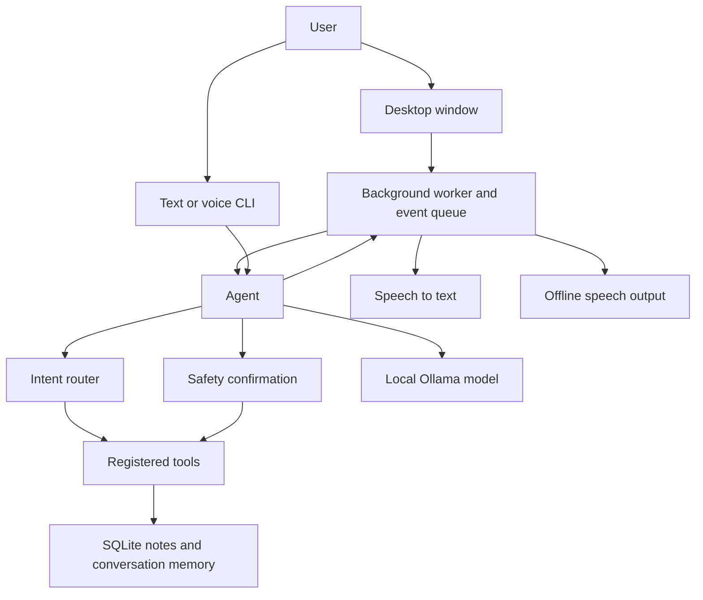

# Divyaraj Assistant

**A local-first, voice-enabled personal assistant for Windows that turns natural-language requests into useful, safety-checked actions.**


> The screenshot will appear here once `docs/screenshot.png` is added.

**Status: in development**

## Features

- **Local LLM:** conversational responses and tool calling through Ollama.
- **Voice input and output:** push-to-talk speech recognition with Faster-Whisper
  and offline speech synthesis with Piper (or a `pyttsx3` fallback).
- **Tools with safety confirmations:** risky actions, such as opening an app, require
  explicit approval.
- **Notes and SQLite memory:** create, list, and search notes, with conversation
  history stored locally.
- **Desktop app:** dark CustomTkinter chat window with text entry, push-to-talk,
  voice mute, settings, Ollama retry controls, and a system tray icon.
- **Background controls:** Ctrl+Space (configurable) restores the window and starts
  push-to-talk. A second launch focuses the existing window.
- **Windows startup:** optionally launch the app at sign-in using a removable
  current-user Startup-folder command (off by default).
- **Additional tools:** local time and DuckDuckGo web search.

## Architecture



The desktop window runs recognition, model requests, tool execution, and speech
output in a worker so the interface can remain responsive. The text and voice CLI
use the same agent, tool registry, and safety rules.

## Download

Download **`DivyarajSetup.exe`** from the
[latest GitHub Release](https://github.com/divyarajsingh2021-pixel/divyaraj-assistant/releases/latest).
Releases are built for Windows and install the desktop application.

Windows SmartScreen may warn that the installer is from an unknown publisher.
Divyaraj is currently unsigned; continue only if you downloaded the installer from
the project's official GitHub Releases page.

## Install on Windows

1. Run `DivyarajSetup.exe` and follow the setup wizard.
2. Use the Start Menu shortcut to launch Divyaraj Assistant. The installer can also
   create an optional desktop shortcut.

Python and the Python dependencies are bundled with the installed app.

## First run

On first launch, Divyaraj checks that Ollama is installed and running. If it is
missing or stopped, the setup window offers a download link and a **Retry** button.
Once Ollama is available, Divyaraj downloads the configured Ollama model if needed,
then prepares the selected Faster-Whisper model and the default Piper voice. Progress
is shown in the setup window. These downloads need an internet connection; if one
fails, check the connection and use **Retry**. Setup also checks for missing models
again on later launches.

Settings, the SQLite notes/conversation database, and downloaded speech models are
stored under `%APPDATA%\Divyaraj`, not in the installation directory. This allows
the app to keep working when installed under Program Files.

After setup, use the Start Menu shortcut or run **Divyaraj Assistant** from the
desktop shortcut if you selected one. Click the microphone button for push-to-talk.
The global shortcut defaults to **Ctrl+Space**; it restores the window and starts
listening. Closing the window minimizes Divyaraj to the system tray.

## Run from source

For development, install **Python 3.11** from [python.org](https://www.python.org/downloads/windows/)
and [Ollama for Windows](https://ollama.com/download). Start Ollama and pull the
default model:

```powershell
ollama pull qwen2.5:3b
```

Then from the project directory, create a virtual environment and install the
development dependencies:

```powershell
py -3.11 -m venv .venv
.\.venv\Scripts\Activate.ps1
python -m pip install -e ".[dev]"
```

Launch the GUI:

```powershell
python -m divyaraj --gui
```

For terminal voice mode, run:

```powershell
python -m divyaraj --voice
```

In the GUI, type in the chat box and press **Send** or **Ctrl+Enter**. Click the
microphone button to start recording and click it again to stop. Risky tool requests
display a Yes/No confirmation dialog. Closing the window leaves Divyaraj in the
system tray; choose **Open**, **Mute voice**, or **Quit** from the tray menu. Press
**Ctrl+Space** to show the window and start push-to-talk.

## Voice setup

Speech recognition uses Faster-Whisper's `base` model on CPU with `int8` compute and
automatic language detection. The first-run setup downloads it; set
`WHISPER_MODEL=tiny` in `.env` if you need a smaller model.

The first-run setup downloads the default Piper voice and its configuration for
offline speech. Set `PIPER_MODEL_PATH` in `.env` to use a different voice file. If
Piper or the voice model is unavailable, Divyaraj falls back to Windows speech
voices through `pyttsx3`.

Optional settings can be placed in a local `.env` file (ignored by Git); see
[`.env.example`](.env.example) for the supported variables. `GLOBAL_HOTKEY` defaults
to `ctrl+space`. `START_WITH_WINDOWS` defaults to `false`; enabling it creates
`Divyaraj Assistant.cmd` in the current user's Startup folder, and turning it off
removes that file. The default model is `qwen2.5:3b`, and conversation history and
notes are stored under `%APPDATA%\Divyaraj` on Windows (or the platform's per-user
data directory when running elsewhere).

## How it works

1. The user enters a message in the desktop window or CLI, or speaks through
   push-to-talk.
2. For voice input, Faster-Whisper transcribes speech locally. The agent routes
   common time/date and notes requests directly to the matching tools.
3. Other requests go to the configured Ollama model, which can request registered
   tools during its response.
4. The safety layer asks for explicit approval before a risky tool runs. In the
   desktop app, the approval is shown as a Yes/No dialog.
5. The final response is displayed in chat and, when enabled, spoken using offline
   speech synthesis. Notes and conversation history persist in SQLite.

Web search uses DuckDuckGo and therefore requires an internet connection. Ollama,
conversation memory, notes, and the supported local tools run on the user's machine.

## Roadmap

- Android-installable PWA client.

## Limitations

- **Small models can be inconsistent.** Local models with a modest parameter count
  may misunderstand requests, produce incomplete answers, or fail to request the
  right tool. The agent has lightweight routing for common intents, but this does
  not eliminate model errors.
- **Voice recognition takes CPU and memory.** Faster-Whisper runs on CPU; the `base`
  model can have noticeable startup and transcription latency on an 8 GB laptop.
  Choosing `tiny` reduces resource use but may reduce recognition quality.
- **Voice quality depends on local setup.** If Piper cannot load the downloaded
  voice, speech output falls back to the Windows voices available to `pyttsx3`.
- **Web search is not offline.** DuckDuckGo search requires an internet connection.
- **The desktop installer targets Windows.** An Android-installable PWA remains on
  the roadmap.

## Development

Install the development extras with `python -m pip install -e ".[dev]"`. Run checks
from the project root:

```powershell
ruff check .
pytest
```

To build the Windows one-folder app and installer locally, install the free Inno
Setup 6 compiler and run:

```powershell
.\packaging\build.ps1
```

## License

Divyaraj Assistant is released under the [MIT License](LICENSE).
