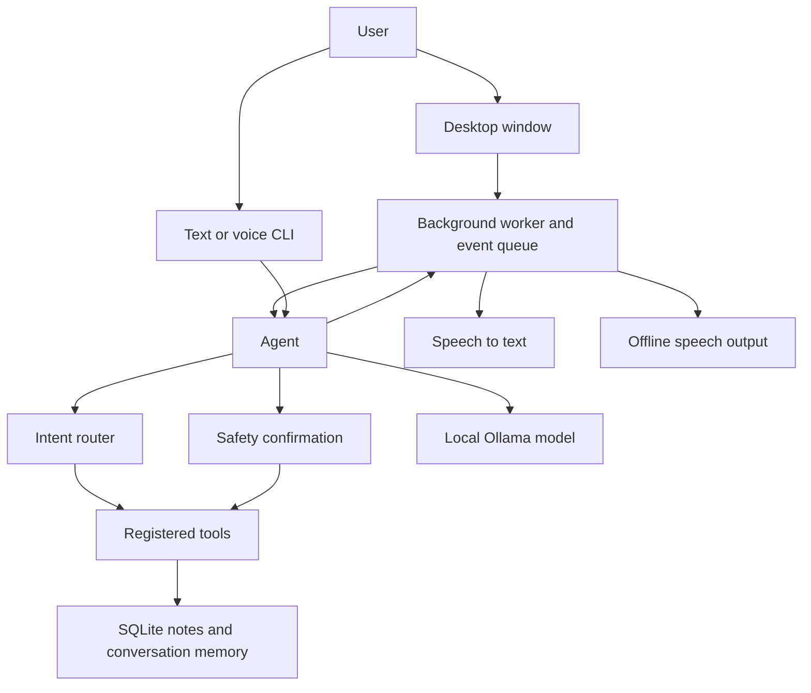

# Divyaraj Assistant

**A local-first, voice-enabled personal assistant for Windows that turns natural-language requests into useful, safety-checked actions.**


> The screenshot will appear here once `docs/screenshot.png` is added.

**Status: in development**

## Features

- **Local LLM:** conversational responses and tool calling through Ollama.
- **Voice input and output:** push-to-talk speech recognition with Faster-Whisper
  and offline speech synthesis with Piper (or a `pyttsx3` fallback).
- **Tools with safety confirmations:** risky actions, such as opening an app, require
  explicit approval.
- **Notes and SQLite memory:** create, list, and search notes, with conversation
  history stored locally.
- **Desktop app:** dark CustomTkinter chat window with text entry, push-to-talk,
  voice mute, settings, and Ollama retry controls.
- **Additional tools:** local time and DuckDuckGo web search.

## Architecture



The desktop window runs recognition, model requests, tool execution, and speech
output in a worker so the interface can remain responsive. The text and voice CLI
use the same agent, tool registry, and safety rules.

## Quick start: Windows

### 1. Install prerequisites

- Install **Python 3.11** from [python.org](https://www.python.org/downloads/windows/).
  During installation, enable **Add Python to PATH**.
- Install [Ollama for Windows](https://ollama.com/download) and start it.

### 2. Download the default model

In PowerShell, pull the default local model:

```powershell
ollama pull qwen2.5:3b
```

### 3. Install Divyaraj

From the project directory, create and activate a virtual environment, then install
the project and development dependencies:

```powershell
py -3.11 -m venv .venv
.\.venv\Scripts\Activate.ps1
python -m pip install -e ".[dev]"
```

### 4. Launch the desktop app

```powershell
python -m divyaraj --gui
```

Type in the chat box and press **Send** or **Ctrl+Enter**. Click the microphone
button to start recording and click it again to stop. Risky tool requests display a
Yes/No confirmation dialog.

### 5. Optional: run voice mode in the terminal

```powershell
python -m divyaraj --voice
```

Press Enter to start push-to-talk and Enter again to finish recording. Use `/mute`
and `/unmute` between turns to control spoken replies. The GUI and CLI share the same
agent and local conversation database.

## Voice setup

Speech recognition uses Faster-Whisper's `base` model on CPU with `int8` compute and
automatic language detection. The first use may download the model; set
`WHISPER_MODEL=tiny` in `.env` if you need a smaller model.

For offline Piper speech, download a voice model and its matching `.onnx.json`
configuration from the [Piper voices collection](https://github.com/rhasspy/piper-voices)
and place them in `models/`. The default model path is
`models/en_US-lessac-medium.onnx`. Set `PIPER_MODEL_PATH` in `.env` to use a different
voice. If Piper or the voice model is unavailable, Divyaraj falls back to Windows
speech voices through `pyttsx3`.

Optional settings can be placed in a local `.env` file (ignored by Git); see
[`.env.example`](.env.example) for the supported variables. The default model is
`qwen2.5:3b`, and conversation history and notes are stored in
`data/divyaraj.db`.

## How it works

1. The user enters a message in the desktop window or CLI, or speaks through
   push-to-talk.
2. For voice input, Faster-Whisper transcribes speech locally. The agent routes
   common time/date and notes requests directly to the matching tools.
3. Other requests go to the configured Ollama model, which can request registered
   tools during its response.
4. The safety layer asks for explicit approval before a risky tool runs. In the
   desktop app, the approval is shown as a Yes/No dialog.
5. The final response is displayed in chat and, when enabled, spoken using offline
   speech synthesis. Notes and conversation history persist in SQLite.

Web search uses DuckDuckGo and therefore requires an internet connection. Ollama,
conversation memory, notes, and the supported local tools run on the user's machine.

## Roadmap

- System tray icon and controls.
- Windows installer.
- Android-installable PWA client.

## Limitations

- **Small models can be inconsistent.** Local models with a modest parameter count
  may misunderstand requests, produce incomplete answers, or fail to request the
  right tool. The agent has lightweight routing for common intents, but this does
  not eliminate model errors.
- **Voice recognition takes CPU and memory.** Faster-Whisper runs on CPU; the `base`
  model can have noticeable startup and transcription latency on an 8 GB laptop.
  Choosing `tiny` reduces resource use but may reduce recognition quality.
- **Voice quality depends on local setup.** Piper requires a separately downloaded
  voice model. Otherwise, speech output depends on the Windows voices available to
  `pyttsx3`.
- **Web search is not offline.** DuckDuckGo search requires an internet connection.
- **The desktop app currently targets Windows.** A system tray integration, installer,
  and Android PWA remain on the roadmap.

## Development

Install the development extras with `python -m pip install -e ".[dev]"`. Run checks
from the project root:

```powershell
ruff check .
pytest
```

## License

Divyaraj Assistant is released under the [MIT License](LICENSE).
